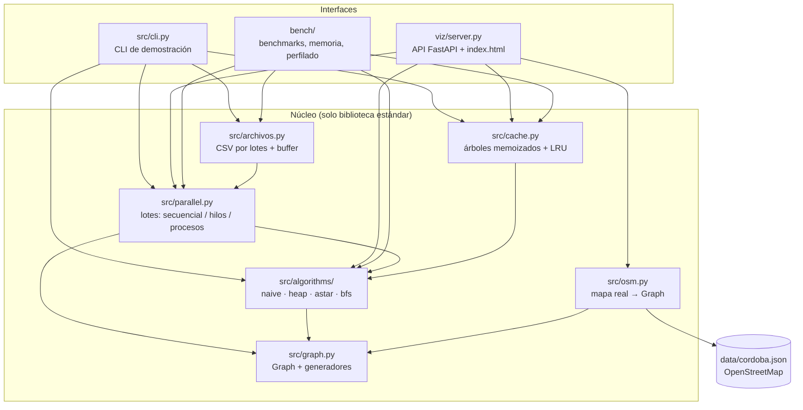
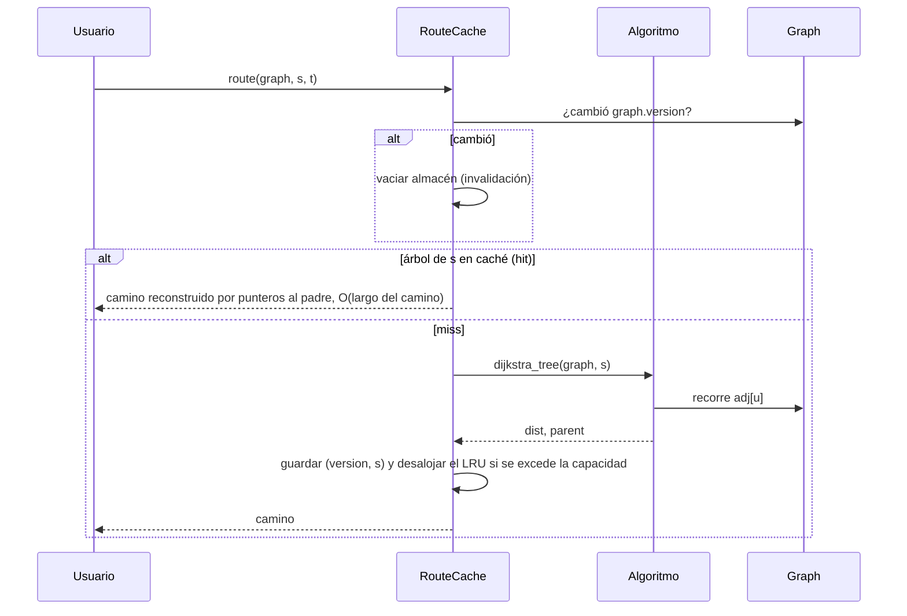

# Arquitectura

El sistema tiene un **núcleo** sin dependencias externas (`src/`) y tres capas que lo
usan sin modificarlo: la CLI, el visualizador web y las herramientas de medición. Todo
cálculo de rutas pasa por el mismo código de `src/algorithms/`, así que lo que se mide
en los benchmarks es exactamente lo que ejecuta la aplicación.

## Diagrama de componentes

## Módulos y responsabilidades

| Módulo | Responsabilidad | Depende de |
| --- | --- | --- |
| `src/graph.py` | Clase `Graph` (lista de adyacencia, coordenadas, contador de versión) y los generadores de las cuatro familias | — |
| `src/algorithms/base.py` | `SearchResult`, protocolo `Algorithm` y reconstrucción del camino | `graph` (solo tipos) |
| `src/algorithms/dijkstra_naive.py` | Línea base O(V² + V·E) | `graph`, `base` |
| `src/algorithms/dijkstra_heap.py` | Dijkstra con heap y corte temprano; `dijkstra_tree` para la caché | `graph`, `base` |
| `src/algorithms/astar.py` | A\* con heurística euclídea admisible | `graph`, `base` |
| `src/algorithms/bfs.py` | BFS para grafos sin pesos | `graph`, `base` |
| `src/algorithms/__init__.py` | Registro único `ALGORITHMS` (nombre → función) | los cuatro algoritmos |
| `src/cache.py` | `RouteCache`: memoiza el árbol por origen, desalojo LRU, invalidación por versión | `dijkstra_heap`, `graph` |
| `src/parallel.py` | Resolución de lotes; `GraphSpec` para reconstruir el grafo en cada proceso | `algorithms`, `graph`, `osm` |
| `src/archivos.py` | Lectura por lotes, escritura con buffer y reparto en procesos | `parallel` |
| `src/osm.py` | Convierte el JSON de OpenStreetMap a `Graph` | `graph` |
| `src/timing.py` | Medición de tiempo compartida | — |
| `src/cli.py` | Subcomandos `ruta`, `comparar`, `simular`, `lote`, `generar-consultas`, `archivo` | todo el núcleo |
| `viz/server.py` | API HTTP del visualizador | núcleo + FastAPI/Uvicorn |
| `data/fetch_cordoba.py` | Descarga única del mapa desde Overpass | biblioteca estándar |
| `bench/` | Benchmarks (pytest-benchmark), control de memoria, perfilado y scripts de las partes 1 y 2 | núcleo |

## Dependencias

| Ámbito | Dependencias | Archivo |
| --- | --- | --- |
| Núcleo `src/` | ninguna (biblioteca estándar) | — |
| Visualizador | `fastapi`, `uvicorn` | `requirements.in` → `requirements.txt` |
| Desarrollo y CI | pytest, ruff, mypy, bandit, pip-audit, mkdocs… | `requirements-dev.in` → `requirements-dev.txt` |
| Perfilado de la parte 2 | scalene, py-spy, snakeviz, pyroscope-io | `requirements-parte2.txt` |

Los `.txt` son *locks*: versiones exactas con hashes, generados con `make lock`. Ver
[Mantenimiento](mantenimiento.md#actualizar-dependencias).

## Flujo de una consulta

## Decisiones de arquitectura

- **Un único registro de algoritmos** (`ALGORITHMS`). La CLI, el paralelismo, los
  archivos y el visualizador lo importan. Antes estaba repetido tres veces (parte 2).
- **El grafo viaja como receta, no como dato.** Los procesos reciben un `GraphSpec`
  (familia, tamaño, semilla) y reconstruyen el grafo una vez. Serializar el grafo en
  cada tarea costaba más que resolverla.
- **El navegador no calcula.** El visualizador solo dibuja. El orden de expansión que se
  anima se captura con el callback `on_expand` del mismo algoritmo que se mide.
