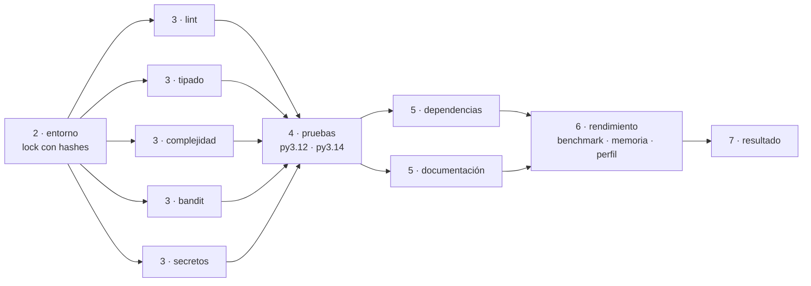

# Integración continua

El pipeline corre en **GitHub Actions** ante cada `push` y cada *pull request* hacia
`main`. Ningún cambio se integra en `main` si el pipeline lo rechaza: la rama está
protegida y exige que el check **"7 · resultado"** esté aprobado.

## Principio: el CI no tiene lógica propia

Cada control es un target del `Makefile`. El workflow solo decide el **orden** y qué
corre en paralelo. Lo que pasa con `make ci` en local pasa en el CI, y lo que falla,
falla igual. Para reproducir un fallo basta con correr el mismo `make <control>`.

## Etapas

| Etapa | Jobs | Duración aprox. | Por qué en este orden |
| --- | --- | --- | --- |
| 1. Integración | push / pull request a `main` | — | disparador |
| 2. Entorno | `entorno` | 30 s | Python fijo + `pip install --require-hashes`; si el lock está roto, no tiene sentido seguir |
| 3. Calidad estática | `lint`, `types`, `complexity`, `sec-code`, `secrets` en paralelo | 30–45 s | no ejecutan código: son los más baratos |
| 4. Pruebas | `test` en Python 3.12 y 3.14 | 35 s | ejecutan el código; solo si el estático pasó |
| 5. Dependencias y docs | `sec-deps`, `docs` en paralelo | 35 s | consultan servicios externos (base de vulnerabilidades, enlaces) |
| 6. Rendimiento | `perf` | 45 s | lo más caro y lo más sensible al ruido; solo sobre código correcto |
| 7. Resultado | `resultado` | 3 s | tabla aprobado/rechazado en el resumen de la corrida |

El entorno de cada job se prepara con la action compartida
`.github/actions/preparar`: mismo Python y dependencias instaladas solo desde el lock.
El runner está fijado en `ubuntu-24.04`, porque `ubuntu-latest` cambia de versión sin
aviso.

Además corren dos workflows independientes: **CodeQL** (push, PR y semanal) y la
**publicación de esta documentación** en GitHub Pages (push a `main`).

## Matriz de controles

| Control | Qué verifica | Herramienta | Comando | Reporte | Rechaza si |
| --- | --- | --- | --- | --- | --- |
| Pruebas | correctitud | pytest | `make test` | `junit.xml` | falla una prueba |
| Cobertura | código ejecutado por las pruebas | pytest-cov | `make test` | `coverage.xml`, `htmlcov/` | cobertura de `src/` < 90 % |
| Análisis estático | errores, estilo, mantenibilidad | Ruff, Pylint | `make lint` | `ruff.sarif`, `pylint.txt` | cualquier error de Ruff, formato no aplicado o Pylint < 9,5 |
| Complejidad | complejidad ciclomática | Radon, Xenon | `make complexity` | `radon_cc.txt`, `radon_mi.txt` | una función o módulo peor que rango C (CC > 20) o promedio peor que A |
| Tipado | tipos y contratos | mypy | `make types` | `mypy.txt` | cualquier error; toda función de `src/` debe estar anotada |
| Vulnerabilidades (código) | patrones inseguros | Bandit, CodeQL | `make sec-code` | `bandit.sarif`, `bandit.txt` | severidad alta con confianza media o alta |
| Secretos | credenciales en todo el historial del commit que se integra | gitleaks | `make secrets` | `gitleaks.sarif` | cualquier hallazgo |
| Dependencias | vulnerabilidades conocidas, versiones reproducibles | pip-audit, Dependabot | `make sec-deps` | `pip-audit.md`, `pip-audit.json` | cualquier vulnerabilidad no exceptuada |
| Documentación | el sitio se construye, estilo, enlaces válidos | MkDocs, markdownlint-cli2, Lychee | `make docs` | `site/`, `lychee.md` | advertencia de MkDocs, error de estilo o enlace roto |
| Benchmark | tiempo de operaciones representativas | pytest-benchmark | `make bench-baseline` + `make bench` | `bench.json` | mediana > +25 % contra la base |
| Memoria | pico de memoria | tracemalloc | `make memory` | `memory.json` | pico > límite (medido +30 %) |
| Profiling | funciones que más tiempo consumen | pyinstrument, cProfile | `make profile` | `profile.html`, `profile_top20.txt` | informativo, no rechaza |

Todos los umbrales están definidos en un solo lugar, al principio del `Makefile`.

### Por qué cada criterio es distinto

Las pruebas son deterministas: un fallo es un fallo. Los benchmarks y la memoria
dependen del entorno, así que necesitan **tolerancia, repetición y una línea base
comparable**:

- **Benchmark:** la línea base se mide en el mismo runner y en el mismo job, al menos
  10 rondas, por mediana y con tolerancia de 25 %. El ruido medido entre corridas
  iguales es menor a 2 %. Detalle en [Rendimiento](rendimiento.md#benchmark-del-ci).
- **Memoria:** tracemalloc es determinista con la misma versión de Python, así que
  alcanza con un límite fijo con margen de 30 %.
- **Profiling:** la instrumentación distorsiona los tiempos; se publica para el
  diagnóstico, pero no se usa como umbral.
- **Complejidad:** rango C (y no B) porque `dijkstra_naive`, con CC 13, es la línea base
  a propósito. El límite atrapa funciones nuevas inmanejables sin obligar a
  "optimizar" la referencia.

## Qué ocurre cuando un control falla

1. El job falla y los jobs que dependen de él no corren (aparecen como *skipped*).
2. **"7 · resultado"** termina en rojo con la tabla de qué falló.
3. La protección de `main` impide integrar el PR.
4. Los reportes quedan como artefactos de la corrida, incluso si el job falló.
5. Los hallazgos de seguridad aparecen además en *Security → Code scanning*.

Cómo resolver cada fallo: [Mantenimiento](mantenimiento.md#resolver-fallos-del-pipeline).

## Seguridad del propio pipeline

- Permisos mínimos: `contents: read` por defecto; `security-events: write` solo en los
  jobs que suben SARIF.
- Actions de terceros fijadas por **SHA** del commit, no por etiqueta (una etiqueta se
  puede mover). Dependabot las actualiza.
- `persist-credentials: false` en cada checkout: el token no queda en `.git/config`.
- Binarios descargados (gitleaks, lychee) con versión fija y **checksum verificado**.
- Los workflows se analizan con CodeQL (`language: actions`).
